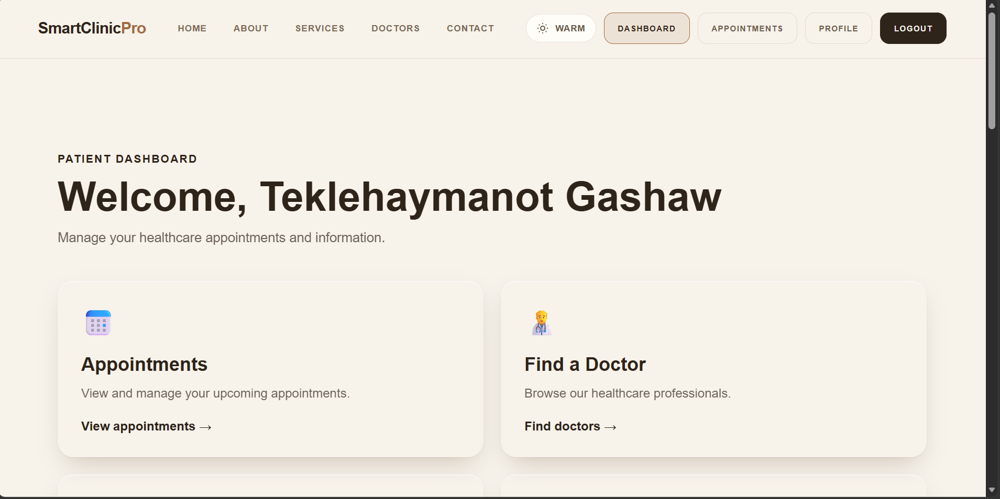
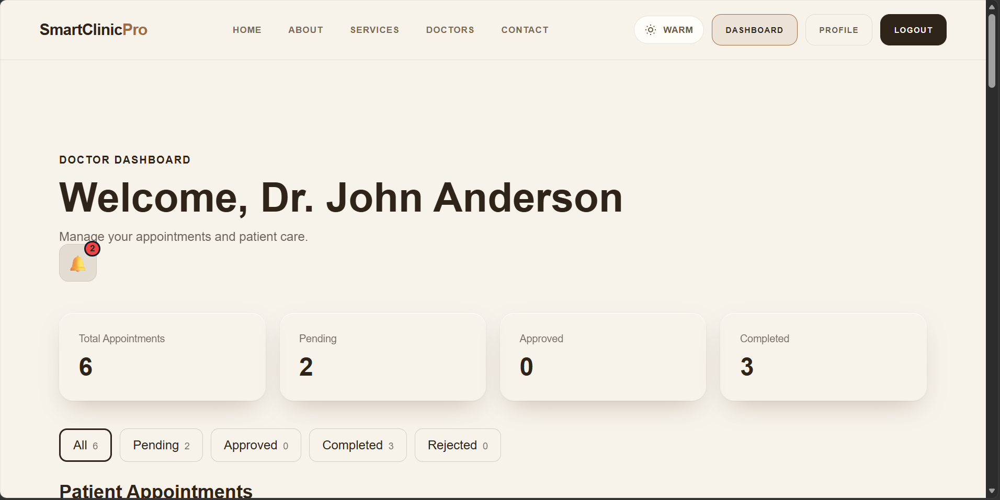
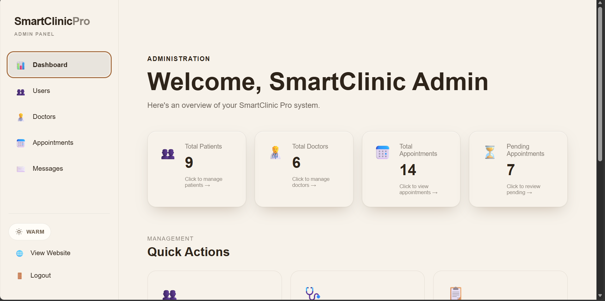

# SmartClinic Pro

A full-stack clinic management platform connecting patients, doctors, and administrators through a single role-aware application. Patients discover providers and book appointments; doctors manage their schedule and patient records; administrators oversee users, doctors, appointments, and inbound enquiries.

**Stack:** React 19 + Vite 8 · Express 5 · PostgreSQL · JWT authentication

---

## Links

| | |
|---|---|
| **Live application** | https://smartclinic-pro-frontend.onrender.com |
| **Backend health check** | https://smartclinic-pro.onrender.com/api/health |
| **Source repository** | https://github.com/sep-tek/smartclinic-pro |

---

## Screenshots

### Homepage


The public landing page: hero section, navigation across the marketing pages, and authenticated account controls in the header.

### Patient dashboard



Role-scoped patient home, with quick actions for managing appointments and browsing the doctor directory.

### Doctor dashboard



Doctor view with appointment totals broken down by status, an unread notification indicator, and filter chips for narrowing the patient appointment list.

### Admin dashboard



The admin shell: sidebar navigation plus platform-wide statistics, each card linking through to the matching management area.

---

## Features

### Public

- Home, About, Services, Doctors, and Contact pages
- Service directory with per-service detail pages (content served from a local data module)
- Doctor directory and individual doctor profiles
- Contact form with database-backed message storage
- Privacy Policy and Terms & Conditions pages
- Custom 404 page for unmatched routes
- Responsive navigation with a mobile drawer

### Authentication

- Account registration and login
- Stateless JWT sessions, delivered both as a bearer token and as an httpOnly cookie
- Password hashing with bcrypt at cost factor 12
- Role-based authorization (patient / doctor / admin) on both client and server
- Active / deactivated account state enforced at request time
- Per-account login throttling keyed on a SHA-256 hash of the submitted email address
- Generic authentication responses that do not disclose whether an address is registered

### Patient

- Patient dashboard
- Browse available doctors
- Book appointments
- View and track personal appointment status
- Update profile and change password

### Doctor

- Doctor dashboard scoped to the authenticated doctor
- View assigned patients
- Update appointment status (approve, complete, cancel)
- Read-only patient details for patients assigned to that doctor
- Update own profile

### Administrator

- Dashboard with appointment and user statistics
- User management with search, filtering, and activate / deactivate controls
- Doctor management — create, update, and delete doctor accounts
- Appointment management with status filtering
- Contact message management
- Dedicated pages for dashboard, users, doctors, appointments, and enquiries

### Cross-cutting

- Responsive layout across desktop, tablet, and mobile
- Centralised API client with unified error handling
- Rate limiting on general API, authentication, and contact endpoints
- Security headers via Helmet, CORS restricted to a configured origin

---

## Technology Stack

### Frontend

| Package | Role |
|---|---|
| React 19 | UI runtime |
| React Router 7 | Client-side routing |
| Vite 8 | Dev server and production build |
| `motion` | Animation |
| `three` | 3D hero scene |

### Backend

| Package | Role |
|---|---|
| Express 5 | HTTP framework |
| `pg` | PostgreSQL client |
| `jsonwebtoken` | Token signing and verification |
| `bcryptjs` | Password hashing |
| `helmet` | Security response headers |
| `cors` | Cross-origin policy |
| `express-rate-limit` | Request throttling |
| `dotenv` | Environment loading |

### Database

PostgreSQL, accessed through `pg`. Tables: `users`, `doctors`, `services`, `appointments`, `contact_messages`.

---

## Prerequisites

- **Node.js 24** (the pinned version in `render.yaml` is `24.21.0`)
- **npm**
- **PostgreSQL 14 or later**, running locally
- **Git**

---

## Local Setup

### 1. Clone

```bash
git clone https://github.com/sep-tek/smartclinic-pro.git
cd smartclinic-pro
```

### 2. Install dependencies

Frontend, from the repository root:

```bash
npm install
```

Backend:

```bash
cd backend
npm install
cd ..
```

### 3. Create the database

```bash
createdb smartclinic
```

Schema and seed data are applied by the backend initialiser:

```bash
cd backend
npm run db:init
cd ..
```

### 4. Configure environment variables

Create `backend/.env`. Set the variable **names** below — supply your own values, and never commit this file.

```env
NODE_ENV=development
PORT=5000

DB_HOST=localhost
DB_PORT=5432
DB_NAME=smartclinic
DB_USER=
DB_PASSWORD=

JWT_SECRET=
CLIENT_URL=http://localhost:5173
```

| Variable | Required | Purpose |
|---|---|---|
| `NODE_ENV` | Yes | Runtime classification. See the note below. |
| `PORT` | No | Backend listen port. Defaults to `5000`. |
| `DB_HOST` | Yes | PostgreSQL host. |
| `DB_PORT` | Yes | PostgreSQL port, e.g. `5432`. Falls back to `5432` in development, but production startup validation rejects the server if it is unset. |
| `DB_NAME` | Yes | Database name. |
| `DB_USER` | Yes | Database user. |
| `DB_PASSWORD` | Yes | Database password. |
| `DB_SSL_STRICT` | No | Set to `1` to enforce full TLS certificate verification against managed providers such as Neon. |
| `JWT_SECRET` | Yes | Token signing secret. Must be at least 32 characters. |
| `CLIENT_URL` | Yes | Allowed CORS origin — the frontend URL. |
| `LOGIN_MAX_FAILURES_PER_ACCOUNT` | No | Failed sign-ins allowed per account per window. Defaults to `10`. |
| `LOGIN_FAILURE_WINDOW_MS` | No | Length of that window in milliseconds. Defaults to `900000` (15 minutes). |
| `LOGIN_MAX_TRACKED_ACCOUNTS` | No | Cap on concurrently tracked accounts. Defaults to `50000`. |

The frontend reads one build-time variable, `VITE_API_BASE_URL`, which defaults to `http://localhost:5000`. It is optional for local development; set it in `.env` at the repository root if the backend runs elsewhere.

#### About `NODE_ENV`

Only `development` and `test` are treated as non-production. Every other value — including an unset or misspelled one such as `prod` — is treated as **production**, so a typo cannot silently disable the production safeguards (startup validation, HSTS, encrypted database connections, secure cookies). Set `NODE_ENV=development` for local work and `NODE_ENV=production` on the deployed service.

---

## Commands

### Frontend (repository root)

| Command | Action |
|---|---|
| `npm run dev` | Start the Vite development server |
| `npm run build` | Production build into `dist/` |
| `npm run preview` | Serve the production build locally |
| `npm run lint` | Run ESLint across the project |

### Backend (`backend/`)

| Command | Action |
|---|---|
| `npm start` | Start the server (`node server.js`) |
| `npm run dev` | Start with `nodemon` file watching |
| `npm run db:init` | Apply the database schema and seed data |
| `npm run smoke` | End-to-end smoke test against a running backend and database |

### Tests

The backend ships an automated test suite built on the Node.js built-in test runner — no test framework dependency is required.

```bash
cd backend
node --test "tests/**/*.test.js"
```

This covers key derivation and normalisation for the login throttle, per-account throttling and counter reset, window expiry, memory-cap eviction, global authentication limiter thresholds, response indirection for unknown, wrong-password, and deactivated accounts, and malformed input handling.

> The smoke test (`npm run smoke`) requires a running backend and a reachable database and performs create-then-cleanup operations. Do not point it at production.

---

## API

The backend exposes a JSON API under `/api`.

| Mount | Responsibility |
|---|---|
| `/api/health` | Liveness and database reachability check (public) |
| `/api/auth` | Registration, login, logout |
| `/api/appointments` | Appointment booking and patient-scoped access |
| `/api/doctors` | Public doctor directory |
| `/api/doctor-dashboard` | Doctor-scoped patients, profile, and status updates |
| `/api/users` | Administrative user management |
| `/api/admin/dashboard` | Administrative statistics |
| `/api/admin/appointments` | Administrative appointment management |
| `/api/admin/contact-messages` | Administrative enquiry management |
| `/api/contact` | Public contact form |

All routes except `/api/health`, registration, login, and the public contact form require a valid JWT. Role-restricted mounts additionally verify the caller's role against a database lookup rather than trusting the token claims alone.

---

## Project Structure

```text
smartclinic-pro/
├── backend/
│   ├── config/          # Shared environment classification
│   ├── database/        # Schema and initialiser
│   ├── middleware/      # Authentication and authorization
│   ├── routes/          # Express routers
│   ├── tests/           # Node test-runner suites
│   ├── utils/           # Validation and auth helpers
│   ├── db.js
│   ├── server.js
│   └── package.json
│
├── src/
│   ├── api/             # Centralised fetch wrapper
│   ├── components/      # Shared components and route guards
│   ├── context/         # Authentication context
│   ├── data/            # Static content modules
│   ├── hooks/
│   ├── layouts/         # Public and admin shells
│   ├── pages/           # Route components
│   ├── routes/          # Route definitions
│   └── main.jsx
│
├── public/              # Static assets
├── render.yaml          # Render Blueprint (frontend static site)
├── package.json
└── README.md
```

---

## Deployment

The application is deployed to Render as **two independent services**.

### Frontend — static site

Declared in `render.yaml` and therefore reproducible from the repository:

- Runtime: `static`
- Build: `npm ci && npm run build`
- Publish path: `./dist`
- `NODE_VERSION` pinned to `24.21.0`
- An SPA rewrite sends all unmatched paths to `/index.html`, so deep links such as `/doctors`, `/login`, and `/register` survive a direct visit or refresh while real assets continue to be served normally

`VITE_API_BASE_URL` is declared with `sync: false`. It is a build-time value that Vite bakes into the bundle, and it is kept in the Render dashboard rather than in version control — without it a rebuild would fall back to `http://localhost:5000` and break every API call.

### Backend — web service

The backend is configured **only in the Render dashboard** and is intentionally not declared in `render.yaml`, because it needs environment variables and a managed PostgreSQL connection that should not live in git.

Required environment variables on that service:

- `NODE_ENV=production`
- `JWT_SECRET` — at least 32 characters
- `CLIENT_URL` — the deployed frontend URL
- `DB_HOST`, `DB_PORT`, `DB_NAME`, `DB_USER`, `DB_PASSWORD`

The database itself is a managed PostgreSQL instance (Neon). Because the server binds TLS to it automatically in production, set `DB_SSL_STRICT=1` once your provider supplies a matching certificate authority for your endpoint.

---

## Security

- Passwords hashed with bcrypt at cost factor 12; plaintext passwords are never stored or logged
- JWT sessions with a pinned `HS256` algorithm, signed httpOnly cookies, and same-site protection
- Authorization derived from a database lookup rather than from client-supplied claims
- Per-account login throttling keyed on a hashed, normalised email address, with a successful sign-in clearing the counter
- Identical response bodies and status codes for unknown, wrong-password, and deactivated accounts, including a fixed-cost dummy comparison to avoid a timing oracle
- Global throttling on the general API, authentication, and contact endpoints
- Helmet security headers and CORS restricted to a configured origin
- Express `trust proxy` left at its secure default, so no forwarded client-IP header is trusted and rate-limit keys cannot be forged
- Startup validation that refuses to boot in production when required configuration is missing
- `.env` files excluded from version control

---

## License

MIT — see [LICENSE](LICENSE).

---

## Author

**Teklehaymanot Gashaw** — Software Engineering Student
[github.com/sep-tek](https://github.com/sep-tek)
